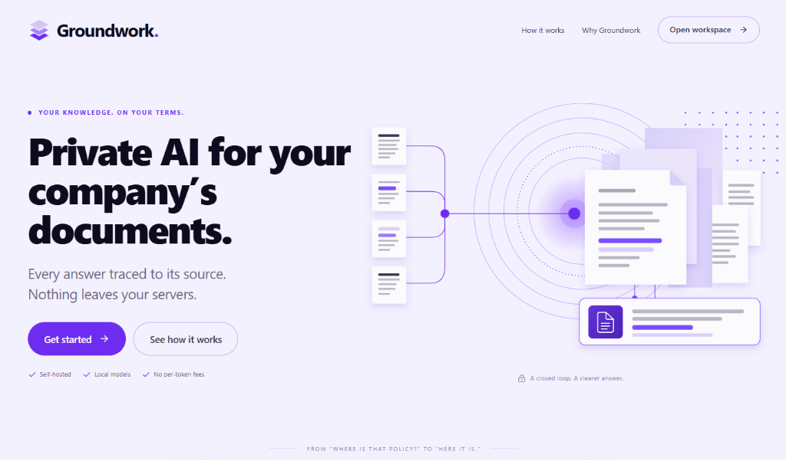
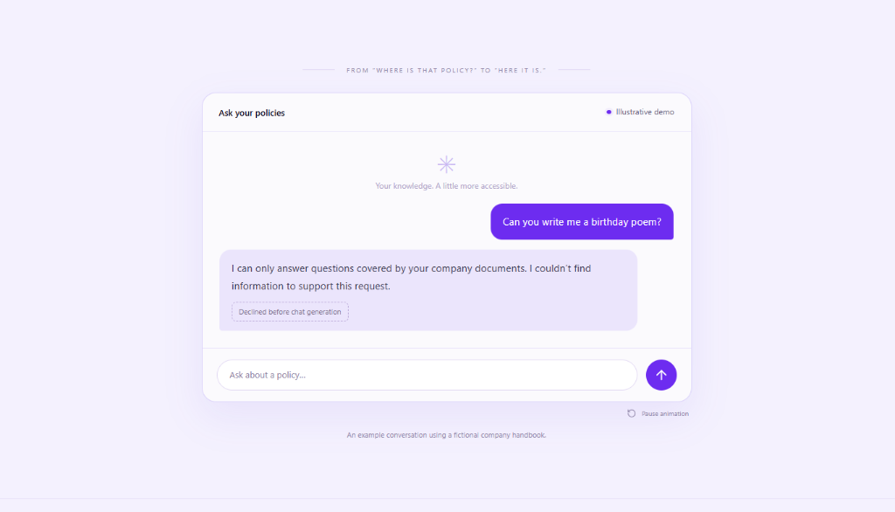
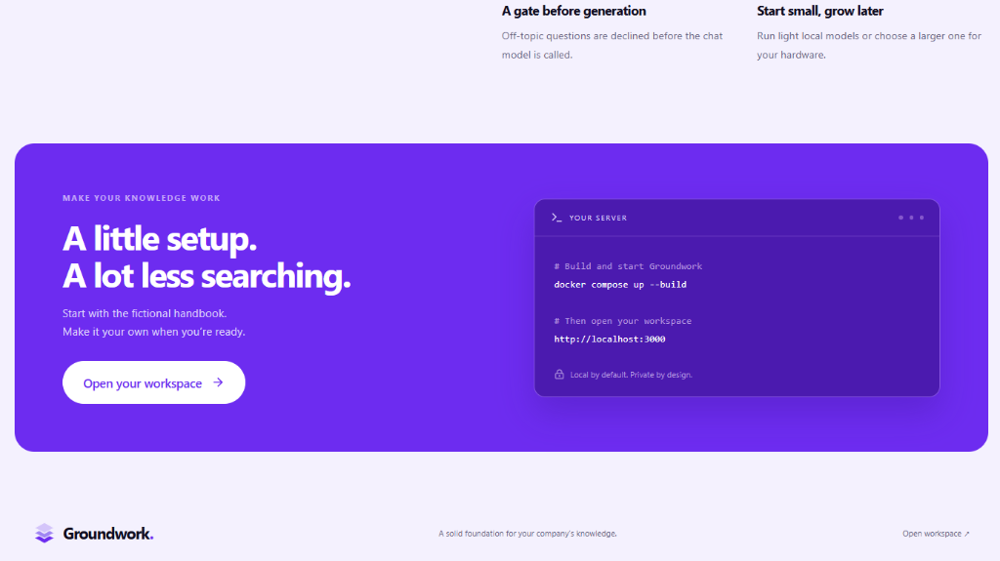
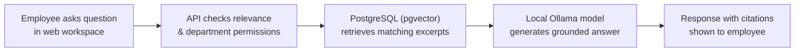

# Groundwork — Private, Self-Hosted Enterprise AI for Company Documents & Policies

> *"Your knowledge. On your terms. Every answer traced to its source — nothing leaves your servers."*

[-black?style=for-the-badge&logo=next.js)](https://nextjs.org/)
[](https://nodejs.org/)
[](https://github.com/pgvector/pgvector)
[](https://ollama.ai/)
[](https://www.docker.com/)

**Groundwork** is an open-source, air-gapped retrieval-augmented generation (RAG) platform that enables companies and enterprises to query internal handbooks, compliance policies, standard operating procedures (SOPs), and operational manuals without sending sensitive corporate documents or employee questions to third-party cloud APIs.

---

## System Overview

### 1. Landing & Knowledge Architecture
A focused entry point showcasing self-hosted AI, document source tracing, and zero per-token fees:



---

### 2. Guardrailed Policy Q&A with Citation Proof
Answers are generated strictly from indexed company documents. Off-topic queries are caught and declined before the language model is called:



---

### 3. One-Command Self-Hosted Deployment
Launch the full stack locally on your hardware with Docker Compose:



---

## What Makes Groundwork Different

- **100% Data Sovereignty:** Everything runs locally. Documents, embeddings, questions, and responses stay strictly inside your firewall on your server hardware.
- **Pre-Generation Safety Gate:** Unlike general-purpose chatbots that attempt to answer every question, Groundwork checks if a question actually matches indexed corporate policies. Off-topic queries (e.g., creative writing, general trivia) are rejected before calling the LLM.
- **Inspectable Source Citations:** Every generated response links directly to the specific document, section, and page excerpt used to produce the answer.
- **Department-Level Access Control (RBAC):** Restrict sensitive documents (e.g., HR grievances, executive compensation) to specific departments or administrative roles.
- **Local Model Flexibility:** Powered by local Ollama instances (`llama3.2:3b`, `qwen2.5`, `nomic-embed-text`). No API keys or external billing required.

---

## How It Works (Simple Architecture)



1. **Ingestion & Embedding:** Company documents (`.pdf`, `.docx`, `.md`, `.txt`) are split into semantic chunks and embedded locally using `nomic-embed-text` into PostgreSQL via `pgvector`.
2. **Relevance Filter:** When an employee asks a question, the system filters by the user's department permissions and computes semantic cosine similarity.
3. **Grounded Generation:** If the relevance threshold is satisfied, the retrieved context is passed to a local LLM (`llama3.2:3b`) to produce a concise summary with exact citations.

---

## Quickstart & Local Setup

### Prerequisites
- [Docker](https://docs.docker.com/get-docker/) & [Docker Compose](https://docs.docker.com/compose/) (v2.24+ recommended)
- 8 GB+ RAM (recommended for running local 3B parameter models)

### 1. Clone the Repository
```bash
git clone https://github.com/dastageerb/Groundwork.git
cd Groundwork
```

### 2. Configure Environment
```bash
cp .env.example .env
```
Generate a secure session secret and update `.env`:
```bash
# On Linux / macOS / WSL:
openssl rand -hex 32

# Or using Node:
node -e "console.log(require('crypto').randomBytes(32).toString('hex'))"
```

### 3. Launch Services
```bash
docker compose up --build
```
*Note: On first startup, Docker automatically pulls the required base images, sets up PostgreSQL with `pgvector`, and downloads the local embedding and chat models via Ollama.*

### 4. Open Your Workspace
Navigate to **[http://localhost:3000](http://localhost:3000)** in your browser and click **Open workspace**.

> **Existing Ollama Setup:** If you already have Ollama running on your host machine, you can run Groundwork without downloading the bundled Ollama image:
> ```bash
> docker compose -f compose.yaml -f compose.host-ollama.yaml up --build
> ```

---

## Technology Stack

| Layer | Technologies |
|---|---|
| **Web Frontend** | Next.js 16 (Turbopack), React 19, Lucide Icons |
| **API Backend** | Node.js, Express.js |
| **Database & Vector Store** | PostgreSQL 16 + `pgvector` extension |
| **Local Model Inference** | Ollama (`llama3.2:3b` + `nomic-embed-text`) |
| **Authentication** | Local Accounts + Optional Company OIDC (Google Workspace / Microsoft 365) |
| **Containerization** | Docker, Docker Compose |

---

## Repository Structure

```
Groundwork/
├── apps/
│   ├── web/               # Next.js frontend (Landing page + Workspace UI)
│   └── api/               # Express backend, ingestion pipeline, and RAG service
├── sample-docs/           # Sample company handbooks and policies for testing
├── deploy/                # Reverse proxy and production deployment configs
├── compose.yaml           # Core Docker Compose orchestration
├── compose.host-ollama.yaml # Override for host-installed Ollama
└── docs/                  # Architecture specifications and documentation
```

---

## License & Contributing

Groundwork is open-source under the [MIT License](LICENSE). Contributions, feature requests, and issue reports are welcome.

---

*Engineered by **Ghulam Dastageer** — Full-Stack Developer.*

### Removing accounts and reviewing feedback

Administrators can open a person in People and choose **Delete account**. The last
administrator and last permanent local recovery administrator cannot be removed.
Deletion revokes sessions and memberships and prevents the same linked company
identity from being automatically provisioned again. A tombstone and answer history
are retained; this is access removal, not personal-data erasure. Usernames and emails
on removed accounts remain reserved. The password-reset CLI cannot reactivate them.

Answer activity shows **Not helpful**, **Helpful**, and **Note received** labels on
collapsed rows. Feedback notes show an explicit sent state and allow retry after a
15-second browser timeout; the server upsert makes retries safe. The answer prompt
requests only facts responsive to the question, and displayed citations are compactly
numbered. Structural validation and valid source numbers still do not prove semantic
support or relevance; model-quality evaluation has not been run.
