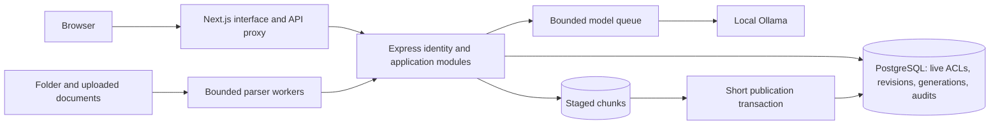

# Groundwork architecture

Updated 18 October 2026. This describes the implemented source, not verified
deployment behavior. See [verification](verification.md) and the
[review implementation status](architecture-review.md).

## Services and boundaries

Next.js serves the supplied-design landing page, workspace, and widget. Same-origin
API requests proxy to Express. Express owns identity, access, document management,
retrieval, indexing, answer lifecycle, and audit/feedback. PostgreSQL/pgvector
stores the persistent state and performs exact cosine search. Ollama runs local
embedding and chat models. Compose publishes only the web port.

The optional `compose.host-ollama.yaml` override uses Ollama already running on
the Docker Desktop host. It removes the API's bundled Ollama dependency and puts
that container behind an inactive profile; the other service boundaries remain
the same.

The four-service architecture remains a modular application. Capacity and outer
rate limits target one API process. PostgreSQL owns account attempt counts and
index job leases; no Redis, external queue, or cloud vector database is required.

## Identity and authorization

### Workspace organization

The sidebar exposes chat, Documents, and (for administrators) People and Answer
activity. Administrators use one Documents screen for the library, uploads,
pasted content, access editing, and ingestion/indexing progress. A compact status row and collapsible
engine details keep indexing controls secondary to the document list. Member document
browsing continues to use retrieval-authorized endpoints. Administration rights
do not enable the read action for a document outside the user's retrieval access.

People presents a read-only user list. Selecting a person opens an editor for
role, email, department membership, and password reset. Its department dropdown
allows creating a department; rename/delete controls are collapsed in that editor.
Department creation persists immediately; membership changes require saving the
user. Department changes refresh the directory and available choices together. Settings
below the profile contains company sign-in configuration, account/password controls,
and administrator embed setup. Initial setup offers Google Workspace, Microsoft 365, or local accounts. A provider
choice creates a recovery administrator then opens that provider’s configuration.
Provider configuration is exposed only in initial setup and administrator Settings;
the public login page has no configuration shortcut. The forced password change
remains a separate sign-in requirement. Settings uses a Team sign-in selector with
Google Workspace, Microsoft 365, and No workspace — local accounts. Without saved
provider settings, local accounts is the default; an explicit provider choice from
first-user setup is carried into its initial configuration screen only. Local selection
hides provider credentials and saves through the revision-checked disconnect operation;
switching an active provider requires confirmation and a usable local administrator.
The embed section explains that the launcher is optional for an existing intranet.

### Sessions and access

Local session issuance rechecks the verified user's credential version under a
row lock. Password changes and all local reset paths increment that version and
delete old sessions atomically. Every authenticated request matches session/user
versions. Argon2 verification is performed outside the session transaction.

OIDC validates issuer/subject, signature, state, nonce, PKCE, and configured
organization restrictions. Verified-email linking is supported; outstanding
temporary local credentials are disabled when such a user signs in through OIDC.
Provider-specific claims and credentials must be configured by the organization.

`company-sign-in.js` manages one Google Workspace or Microsoft 365 provider in
PostgreSQL (migration 004). Admin endpoints return metadata, never client secrets.
AES-256-GCM encrypts secrets with a domain-separated key derived from SESSION_SECRET.
Managed settings start pending; a successful administrator company connection
links their issuer/subject identity and activates company-only login (migration 005).
The login page then renders only the chosen provider. Local session issuance
rechecks the active policy under a short configuration lock, after password hashing.
Existing sessions are retained; operator recovery can disable the managed policy.
Edits to an already active provider preserve company-only mode until disconnected. Explicit environment OIDC configuration
has precedence and is read-only in the UI. Rotating SESSION_SECRET requires saving
the managed provider secret again. Provider calls occur outside DB transactions.
Login state captures a configuration revision; callback validation and the short
provisioning transaction reject changed settings. Updates/disconnect invalidate
stored login states. Successful provisioning records the last provider login time;
saving credentials alone does not establish interoperability or activate a new provider.

Google validates the signed `hd` Workspace domain, not email suffix alone. Microsoft
uses a tenant-specific issuer and `tid`; its email is not trusted for linking or
admin grants. Newly provisioned users are members with no departments. This is
just-in-time provisioning, not directory/group sync or automated offboarding.
Disconnect restores local login, preserves accounts and existing eight-hour sessions,
and requires a local administrator with a permanent password. It removes the managed
client secret. The bootstrap administrator retains their recovery password, usable
only after disconnection or explicit server-operator recovery.

Document access lives on current document/department records. The shared SQL
predicate applies before vector ranking/gating and on document reads. Admin
document editing is an explicit management privilege, separate from department
retrieval rights. Authentication happens at request start; retrieval access is
evaluated in the evidence-selection snapshot. Already-delivered content cannot
be recalled. Historical audit evidence is filtered through current document access.

## Answer sequence

1. Authenticate, validate input, and enter a bounded/cancellable answer queue.
2. Insert a pending audit/answer ID and start SSE status/heartbeat events.
3. Read index identity briefly and release the pool connection. Check the configured
   model digest and pinned alias, then embed without holding a database client.
4. Open a short repeatable-read transaction, confirm generation identity, and
   retrieve authorized current-revision chunks with exact cosine ranking.
   A changed generation returns a retryable conflict rather than an unbounded retry.
5. Apply the similarity threshold and conservative context budget. A no-source
   decline skips chat generation but has used local embedding.
6. Otherwise request structured claims and citation IDs from Ollama. Buffer and
   validate the complete structure and in-range IDs before publishing paragraphs.
   Invalid/unsupported output declines. Valid IDs do not prove semantic truth.
7. Persist the outcome, answer, exact supplied excerpts/revisions, model-call
   status, and elapsed time before sending done with the answer ID.
   Errors/disconnects become failed/cancelled; no successful done is sent if
   audit persistence fails. Periodic maintenance recovers abandoned pending records.

This deliberately trades first-token latency for validation. The SSE transport
publishes validated answer units, not unchecked model tokens. Status events and
heartbeats remain active during model work.

## Index sequence

Index jobs acquire a short transactional advisory lock only to claim/publish work.
A heartbeat lease identifies active jobs; no database client is held during
parsing/embedding. Document ACL edits are independent of this lock.

Each build copies the installed embedding artifact to a digest-named local alias,
records the digest, chunking version, and dependency-lock fingerprint, and prepares one document at a time.
Chunks are inserted incrementally with generation and document revision IDs.
Live content/title edits increment revision and make old chunks ineligible.
Folder changes are discovered at the next build.

Publication checks that the job is still active and marks only still-current,
nondeleted revisions eligible, then atomically changes the active generation.
Permission edits/deletions/newer content cannot be overwritten by publication.
Unchanged documents remain searchable while staging; changed documents are
conservatively unavailable until successfully published.

Original uploaded bytes are not retained; extracted text is stored locally.
Re-parsing after a parser change requires re-upload. Old nonactive vector
generations are cleaned after one day on subsequent successful builds; audits
retain exact evidence excerpts separately. Failed jobs remain visible for diagnosis.

## Capacity, retention, and deployment

- Database acquisition and statement/idle-transaction waits are bounded.
- Model calls share a bounded queue; answer admission and uploaded-file buffering
  have separate limits. PDF/DOCX workers have a time/heap limit and bounded capacity.
  Worker threads are not an operating-system security sandbox.
- Audit/feedback retention defaults to 90 days and is configurable. Periodic cleanup
  also expires sessions/attempt counters and recovers stale answer/build state.
- Model auto-provisioning downloads missing tags only. An installed mutable tag is
  not overwritten at startup. A model change invalidates index compatibility even
  when dimensions match.
- Cross-origin portals use the public launcher script, opening a dedicated
  Groundwork window. Only same-origin framing is permitted on /widget; workspace
  framing remains denied. Session tokens never enter portal URLs or messages.
- OIDC settings, budgets, capacity, and retention are wired through .env.example
  and Compose. Trusted proxy CIDRs are opt-in; forwarded headers require explicit
  sanitization at the perimeter.
- Native development uses the same PostgreSQL/pgvector/Ollama contracts when Docker
  is unavailable. Company payloads stay local; image/model downloads and configured
  identity providers are separately documented network operations.

## Remaining release evidence

The web build/API syntax checks pass. Automated tests are intentionally skipped.
PostgreSQL migrations have executed and the running API reports PostgreSQL and
host Ollama online with both configured models installed. Local-model answer
quality, concurrent authorization behavior, OIDC interoperability, authenticated
browser integration, and hardware capacity still need evidence. See
[verification](verification.md) for the dated deployment and UI checks.

## Account removal and feedback visibility

Migration 006 adds user tombstones. DELETE /api/users/:id takes the shared role-change
lock, rechecks the actor, protects the final admin/recovery admin, and revokes sessions
and memberships in one short transaction. Sessions, SQL access, local login, resets,
user editing/listing, and OIDC reject removed users. OIDC identity tombstones remain to
block automatic re-provisioning. Audit history retains its original user reference.
The account is not erased and its username/email remains reserved.

Collapsed activity rows show rating/note flags. Feedback separates saved rating from
saved note state, retains drafts on failure, and uses a bounded browser request with
idempotent upsert retries. Generation instructions explicitly limit answers to the
requested facts. Duplicate claim text is removed and displayed sources are numbered
in first-use order; audit evidence records answerCitation alongside original candidate
numbers. This is structural control and a prompting improvement, not a guarantee of
semantic relevance or grounding.
